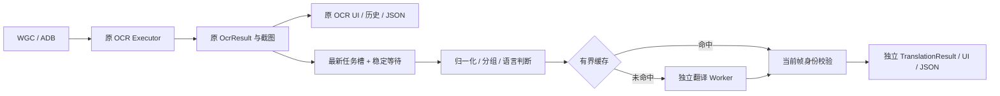

# 独立 Translation Pipeline

`crates/gameocr-translation` 提供 TranslationEngine、Factory、Manifest、Prompt、类型、语言判断、分组、LRU 和 Worker 协议。原生 `HyMtAdapter` 仅在独立 Worker/CLI 中编译。扩展 Runtime 时注册对应 manifest.runtime + adapter、原生加载器和进程路径；不会根据 `.gguf` 后缀猜测模型行为。

桌面 `src-tauri/src/translation` 拥有配置、模型管理、Scheduler、Worker 和历史。复用 `ModelManager::download_file` 的下载校验，以及 `ocr::Worker::request_typed` 的有界 NDJSON 进程传输；两种任务从不共享子进程或推理上下文。共享 NVIDIA 文件的安装操作串行化，防止同时写同一分段下载/收据。

OCR 发布只提交最新文本任务，不等待翻译。一个常驻异步调度循环、一个运行任务、一个可覆盖的待处理任务；不会按帧创建进程。稳定窗口对文字变化重新计时，相同文字不延长等待。Fast/Balanced/Accurate 初值为 80/350/700 ms，可调整；这些是策略参数，不是性能保证。

每个任务携带 frameId、capture generation、OCR epoch 和文本 revision。窗口切换、暂停/停止、模型与翻译设置变化会失效队列。新文字使旧任务的协作取消标记生效：桌面发送带 request_id 的 cancel，Worker 的独立 stdin 线程读取控制消息，生成线程在每段 prompt decode 前和每个生成 Token 前检查标记。单次 native decode 不能中途抢占；取消后清理 KV、丢弃当前 sampler，模型权重保持加载。取消仍返回该请求的终止响应，避免污染下一条 IPC 响应；普通取消不作为 Worker 故障。模型卸载/退出保留进程级关闭保障。

发布必须在与 OCR 共用的 transition gate 下重新核对身份，即使取消恰好晚于推理结束也不能发布旧结果。相同文本跨帧沿用计算/缓存时，关联当前帧的原始 block ID、bbox 和 polygon。原始 OcrResult、坐标、置信度及旧 JSON 字段完全独立。

自动分组按坐标阅读顺序，保守合并相邻、左对齐、字号接近的长句续行；菜单短条目保持独立。支持逐块与整段模式。可将 2–8 个提示词配置相同、需要翻译且均未缓存的短文本合批；单组最多 512 字节，总计最多 2048 字节，每组至少预留 96 个输出 Token。默认 512 Token 下最多合批 5 组。

先固定无需翻译项和缓存命中项，再对剩余 2–8 项执行原有预算检查；仅剩一项时直接推理。缓存命中项先做快照，即使缓存容量较小，插入新译文也不会导致同一批已命中项再次推理。合批 Prompt 使用 JSON 中的稳定编号；返回必须是完整 JSON、条目数相同、编号完整且唯一、译文非空，不能有额外字段。允许数组重排，但不按位置猜配。格式错误、截断或合批失败时只对未命中项逐组重试；只有全部验证通过后才缓存。batchRequestId/batchSize 关联同一批次，整批推理耗时及 Token 只在首个未命中项计入，其余项相应字段为零/空，直接求和不会重复累计。

语言优先级为当前手动覆盖、已选 Profile 默认值、全局默认值。新增可空 sourceLanguageOverride/targetLanguageOverride；UI 的“跟随 Profile”清除覆盖，切换 Profile 也清除当前覆盖。旧文件中与 Profile 不同的全局语言保留为手动覆盖，已复制的相同默认值继续跟随 Profile。明确源语言会进入 Prompt；Auto 才使用轻量字符/词规则。假名是日文证据，纯汉字可以是不确定，短专名不会直接判为中文；纯数字/符号始终跳过。同语言可保留原文。启发式并非通用语言分类器，混排、同形汉字及极短文本仍需要用户选择源语言。

LRU 默认 512 条，最大 4096 条且文字总容量限制 4 MiB。只有非空、未截断且正常 eos 的生成结果可进入缓存，持久快照恢复时过滤旧截断/空项，保留其他项。Key 包括原文、实际生效语言、模型 SHA/revision/runtime/adapter、Prompt 版本、全部采样配置、风格、术语内容/版本和上下文内容/版本。Prompt 版本现为 2，旧版本 Key 不会被新提示词复用，无需用户手动清空缓存。缓存不存帧身份；命中时使用当前 OCR 关联，模型耗时与 token/s 留空/零，避免将缓存算作神经推理成绩。截断输出仍可显示，结果状态为 incomplete，并导出 truncated/stopReason。

持久缓存默认关闭；启用后退出时保存版本 1 有界快照，不支持的旧版本视为失效重建。可手动清空。游戏 Profile 独立 JSON 配置，手动绑定稳定的进程名称，重启游戏后可选回；没有按 PID 绑定。上下文默认关闭，用户确认对白后才加入当前 Profile 的有限窗口，切换目标/设置时清空，短标签不自动附带背景。

Profile 版本由后端保存时维护，仅术语、风格、背景、源/目标语言实际变化时递增对应 Profile；设备、等待时间、名称/窗口绑定及原样保存不递增。导入的更高版本保留，旧版本不会倒退，新建 Profile 至少为 1。

初次加载和重建 Worker 共用有界回退 Helper。Auto 在 CUDA 加载失败时最多尝试一次 CPU；运行中 CUDA Worker 崩溃后下一次请求按 CPU 恢复，后续保持 CPU，直到用户重新加载模型。显式 CUDA 不静默回退，恢复流程不调用 Runtime 下载。

未来 Overlay 可直接消费 TranslationResult 的块关联和原始几何，但须继续携带并校验 generation/epoch/revision。当前只在桌面结果面板展示，不做游戏内绘制、文字替换或 TTS。
