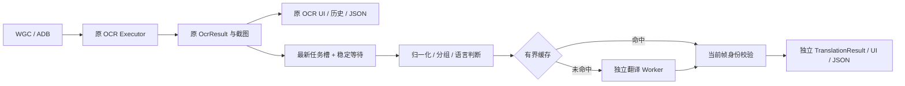

# 独立 Translation Pipeline

`crates/gameocr-translation` 提供 TranslationEngine、Factory、Manifest、Prompt、类型、语言判断、分组、LRU 和 Worker 协议。原生 `HyMtAdapter` 仅在独立 Worker/CLI 中编译。扩展 Runtime 时注册对应 manifest.runtime + adapter、原生加载器和进程路径；不会根据 `.gguf` 后缀猜测模型行为。

桌面 `src-tauri/src/translation` 拥有配置、模型管理、Scheduler、Worker 和历史。复用 `ModelManager::download_file` 的下载校验，以及 `ocr::Worker::request_typed` 的有界 NDJSON 进程传输；两种任务从不共享子进程或推理上下文。共享 NVIDIA 文件的安装操作串行化，防止同时写同一分段下载/收据。

OCR 发布只提交最新文本任务，不等待翻译。一个常驻异步调度循环、一个运行任务、一个可覆盖的待处理任务；不会按帧创建进程。稳定窗口对文字变化重新计时，相同文字不延长等待。Fast/Balanced/Accurate 初值为 80/350/700 ms，可调整；这些是策略参数，不是性能保证。

每个任务携带 frameId、capture generation、OCR epoch 和文本 revision。窗口切换、暂停/停止、模型与翻译设置变化会失效队列。运行任务可以安全结束，但发布必须在与 OCR 共用的 transition gate 下重新核对身份。相同文本跨帧沿用计算/缓存时，关联当前帧的原始 block ID、bbox 和 polygon。原始 OcrResult、坐标、置信度及旧 JSON 字段完全独立。

自动分组按坐标阅读顺序，保守合并相邻、左对齐、字号接近的长句续行；菜单短条目保持独立。支持逐块与整段模式。可将 2–8 个提示词配置相同、需要翻译且均未缓存的短文本合批；单组最多 512 字节，总计最多 2048 字节，每组至少预留 96 个输出 Token。默认 512 Token 下最多合批 5 组。

合批 Prompt 使用 JSON 中的稳定编号；返回必须是完整 JSON、条目数相同、编号完整且唯一、译文非空，不能有额外字段。允许数组重排，但不按位置猜配。格式错误、截断或合批失败时逐组重试；只有验证后的独立译文才进入缓存。部分组已缓存时优先复用它们，只推理变化组。界面可关闭合批，指标中的 batchRequestId/batchSize 明确表示共享的整批耗时与 Token，不把它们重复相加。

Auto 语言检测只使用轻量字符/词规则。假名是日文证据，纯汉字可以是不确定，短专名不会直接判为中文；纯数字/符号跳过。同语言可保留原文。Profile 可提供源语言提示。启发式并非通用语言分类器，混排、同形汉字及极短文本仍需要用户选择源语言。

LRU 默认 512 条，最大 4096 条且文字总容量限制 4 MiB。Key 包括原文、语言、模型 SHA/revision/runtime/adapter、Prompt 版本、全部采样配置、风格、术语内容/版本和上下文内容/版本。缓存不存帧身份；命中时使用当前 OCR 关联，模型耗时与 token/s 留空/零，避免将缓存算作神经推理成绩。

持久缓存默认关闭；启用后退出时保存版本 1 有界快照，不支持的旧版本视为失效重建。可手动清空。游戏 Profile 独立 JSON 配置，手动绑定稳定的进程名称，重启游戏后可选回；没有按 PID 绑定。上下文默认关闭，用户确认对白后才加入当前 Profile 的有限窗口，切换目标/设置时清空，短标签不自动附带背景。

未来 Overlay 可直接消费 TranslationResult 的块关联和原始几何，但须继续携带并校验 generation/epoch/revision。当前只在桌面结果面板展示，不做游戏内绘制、文字替换或 TTS。
